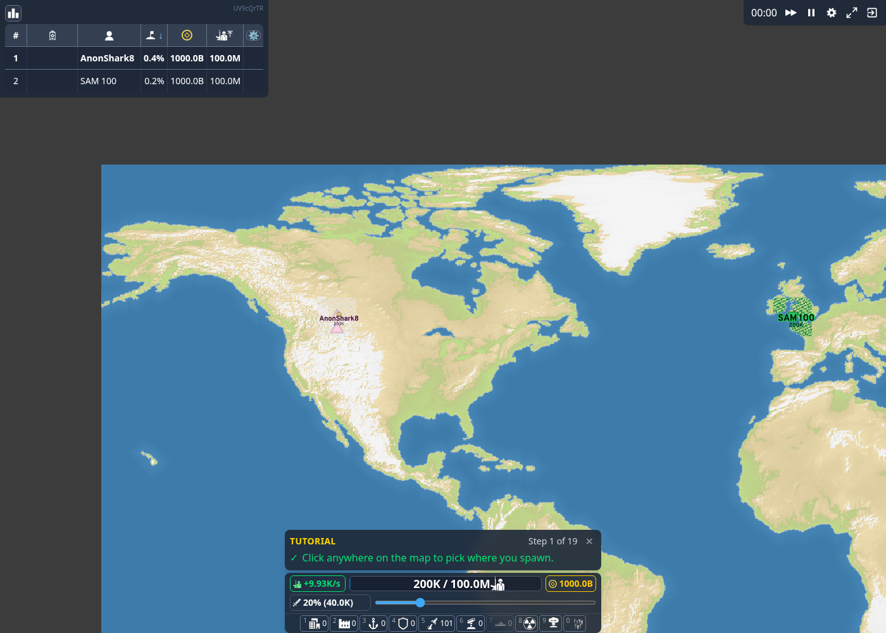
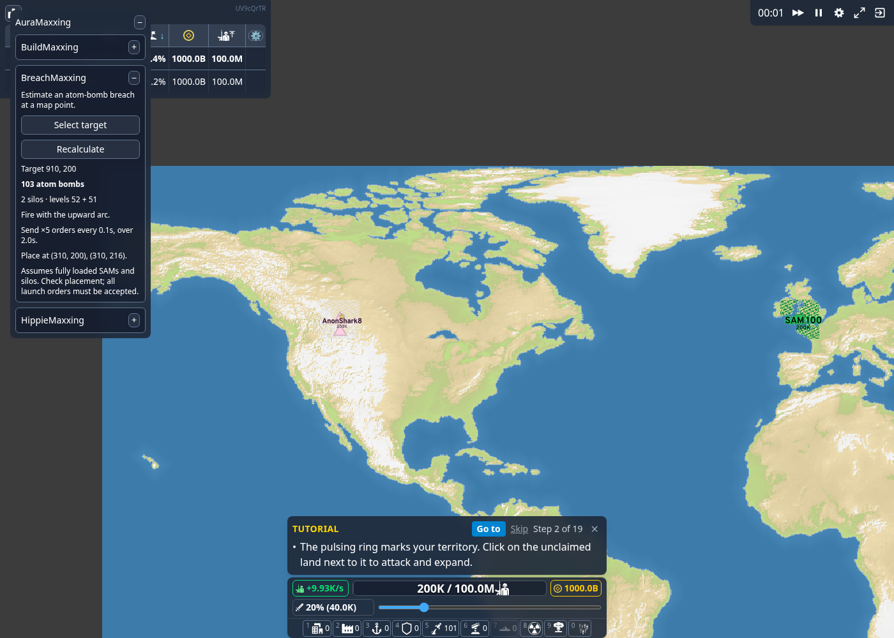

# BreachMaxxing

Read-only atom-bomb calculator. Select a target to get one sufficient hypothetical
configuration, its launch direction, positions and timing. Recalculate when the
positions or levels change. No builds or launch intents are sent.

Both upward and downward arcs are tested automatically. The search prioritizes
fewer silos, then fewer bombs; an upward arc wins ties. It tests one through five
fully loaded silos with balanced levels and at most 300 bombs. Layouts start at
the closest existing silo and extend south at the game's minimum spacing plus
one tile. Bounds are checked; ownership, terrain and build space need checking.
No failed layouts or current-ammunition verdicts are displayed.

Every hostile SAM starts fully loaded at its level's full range, regardless of
its current reload or upgrade progress. SAMs still reload during the simulated
salvo: assuming full initial ammo does not disable their normal recovery.
The fixed-point trajectories, nearest-silo selection, per-silo departure spacing
and SAM targeting windows follow the game. Overlapping SAMs reserve targets to
avoid counting a bomb twice. A reserved interception is assumed successful.

The plan uses one ×5 order per tick (currently 100 ms) and assumes every order is
accepted. Existing missiles, other attacks, new construction and alliance changes
are excluded. The minimum is within the tested layout family, not across all
possible positions. Failure within the search bound does not mean no breach is
possible.

## Verification

- `npm test`: calculator, bridge snapshot, input cleanup, existing features.
- `npm run test:breach-engine`: 13 scenarios against the parent OpenFront engine;
  also checks generated trajectories point for point. Requires the parent repo's
  installed dependencies. Verified against `31937823c`.
- Browser fixture: singleplayer, no nations or tribes, infinite gold and instant
  builds; one enemy SAM 100 and own silos 50 and 51. Software rendering was
  enabled only in the test browser to allow the headless local run.

For a target 600 tiles east of the first silo, with the second 16 tiles south,
using ×5 orders every tick (100 ms): 50+51 and 51+51 are blocked; 52+51 and
34+34+33 breach. All orders at the same tick can make 50+51 breach, but that is
not a server delivery guarantee. Moving the launch site changes the outcome.

Page-world imports exercise the real game and panel but do not validate Chrome's
isolated-world boundary. A real extension reload is required for that last check.

## Screenshots

Same local fixture and 1400 × 1000 viewport. The three units remain
unchanged after selecting the target; the extension logs no runtime errors.

